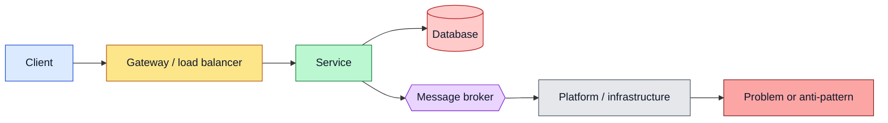

# Microservices

Practical reference notes on microservice **architecture**: when to use it, where to draw service boundaries, and the building blocks every system needs (gateway, discovery, configuration). Each file is a self-contained reference meant to be kept open while designing or reviewing a system: what a thing is, how it fits, a diagram, and the mistakes to avoid.

The examples use a **food-delivery** domain (customers, restaurants, orders, drivers), the same one used in the [NestJS notes](../Nest/README.md), and implementation snippets are NestJS (TypeScript). The ideas themselves are language-independent.

---

## How to read the diagrams

Diagrams are [Mermaid](https://mermaid.js.org/), written as text inside the Markdown. They render in Obsidian and on GitHub, and can be edited like any other text. Colors mean the same thing in every note:

| Color | Meaning |
|---|---|
| Blue | Clients and callers |
| Yellow | Gateway, load balancer, routing |
| Green | Services (healthy, correct) |
| Red | Databases, or problems and anti-patterns (the label says which) |
| Purple | Message broker and events |
| Grey | Platform and infrastructure |

Diagram types used: **flowcharts** for structure, **sequence diagrams** for request and event flows, **state diagrams** for lifecycles, and **class diagrams** for how a concept differs per context.

---

## Topics

| Note | Covers |
|---|---|
| [Monolith vs Modular Monolith vs Microservices](monolith-vs-microservices.md) | The three styles, how one request differs, scaling, a decision flowchart, step-by-step migration, the distributed-monolith trap |
| [Service Boundaries](service-boundaries.md) | Splitting by business capability, bounded contexts, context relationships, data ownership, signals for where to cut, granularity |
| [API Gateway](api-gateway.md) | Responsibilities, request flow, authentication at the edge, aggregation, BFF, gateway vs load balancer vs service mesh |
| [Service Discovery](service-discovery.md) | The registry, client-side vs server-side discovery, health checks, discovery in Docker Compose and Kubernetes |
| [Configuration Management](configuration-management.md) | Config vs secrets, layers and precedence, injecting secrets, centralized config, validated config in NestJS |
| [Reference Architecture](reference-architecture.md) | The whole system in one picture, request and event paths, a full order lifecycle, failure behavior, deployment, observability, build order |

## Suggested reading order

1. [Monolith vs Modular Monolith vs Microservices](monolith-vs-microservices.md): decide whether you need this at all.
2. [Service Boundaries](service-boundaries.md): decide where the lines go.
3. [API Gateway](api-gateway.md): the front door.
4. [Service Discovery](service-discovery.md): how services find each other.
5. [Configuration Management](configuration-management.md): how each one is configured.
6. [Reference Architecture](reference-architecture.md): everything together, with a full order flow.

## Quick lookup

| I need to... | Go to |
|---|---|
| Decide between a monolith and microservices | [Choosing an architecture](monolith-vs-microservices.md#choosing-an-architecture) |
| Move from a monolith to services safely | [Migrating step by step](monolith-vs-microservices.md#migrating-step-by-step) |
| Understand why services sharing a database is a problem | [Data ownership](service-boundaries.md#data-ownership) |
| Decide whether two things belong in one service | [Where to cut: signals](service-boundaries.md#where-to-cut-signals) |
| Add one public entry point for all clients | [Why a gateway](api-gateway.md#why-a-gateway) |
| Combine data from several services in one call | [Aggregation](api-gateway.md#aggregation) |
| Give each client type its own API shape | [Backend for Frontend (BFF)](api-gateway.md#backend-for-frontend-bff) |
| Stop hardcoding service addresses | [The service registry](service-discovery.md#the-service-registry) |
| Make containers reach each other by name | [Discovery in Docker Compose](service-discovery.md#discovery-in-docker-compose) |
| Add health and readiness endpoints | [Health checks](service-discovery.md#health-checks) |
| Keep secrets out of the repo and the image | [Injecting secrets](configuration-management.md#injecting-secrets) |
| Fail at startup on missing config | [NestJS: validated configuration](configuration-management.md#nestjs-validated-configuration) |
| See how events flow through an order | [An order from start to finish](reference-architecture.md#an-order-from-start-to-finish) |
| Plan what happens when a consumer is down | [When a service is down](reference-architecture.md#when-a-service-is-down) |
| Trace one request across services | [Observability](reference-architecture.md#observability) |

## Not covered yet

Topics that build on these notes and are natural next additions: resilience patterns (timeouts, retries, circuit breaker), sagas and the outbox pattern, CQRS and read models, API versioning, and testing strategies across services.
