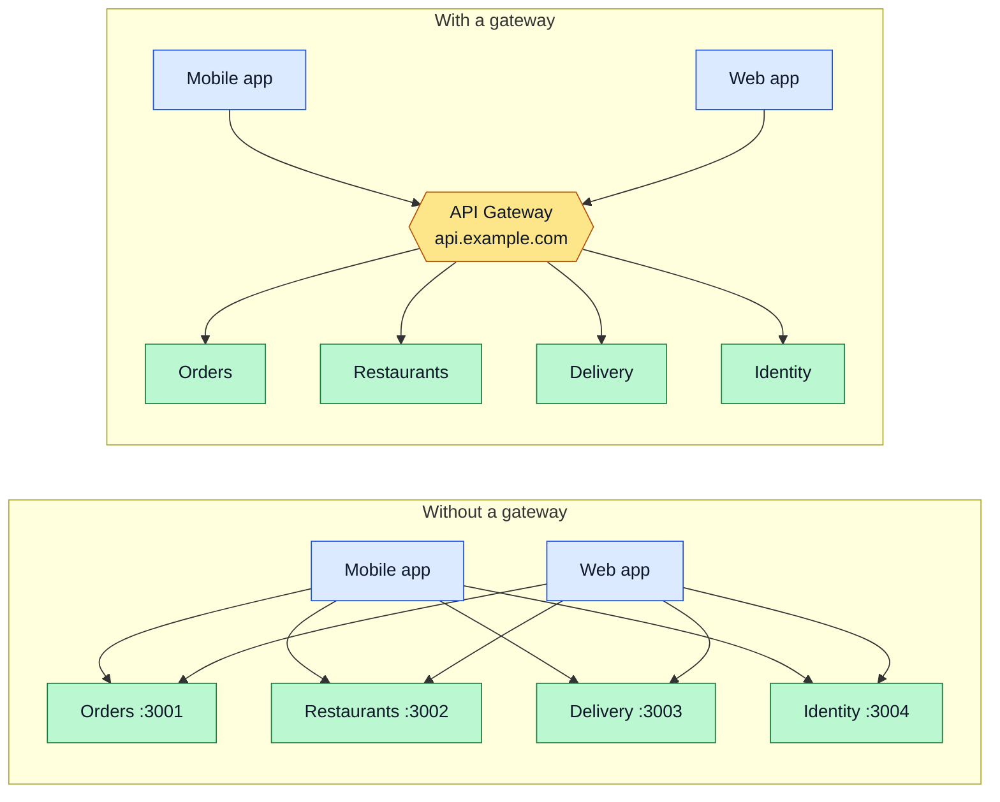
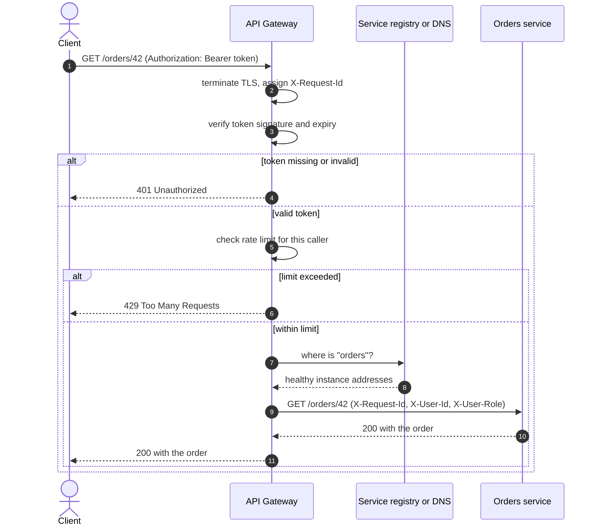
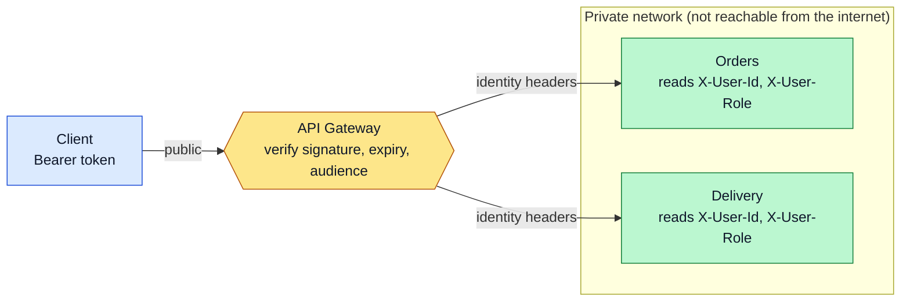
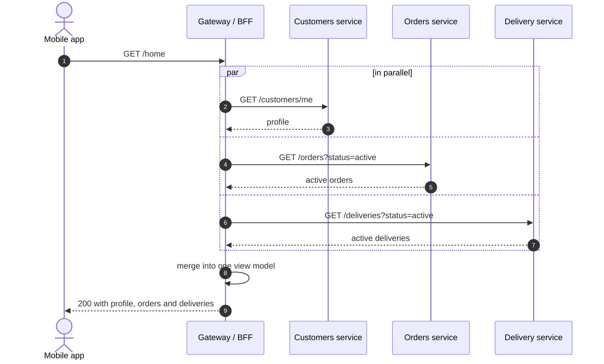
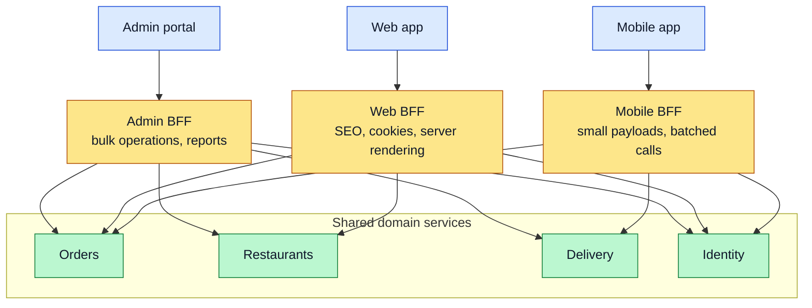
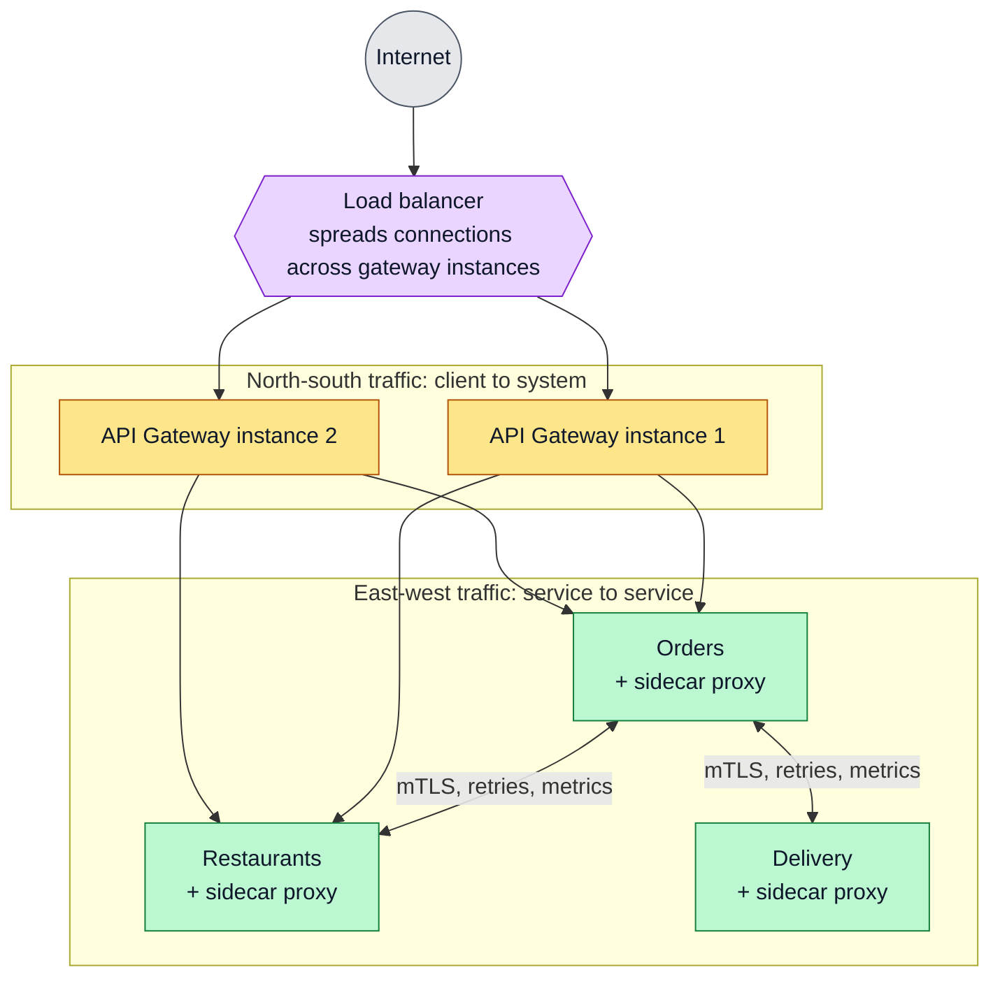
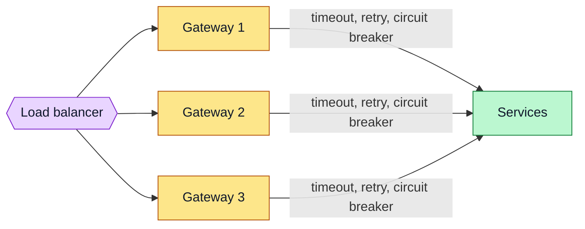

# API Gateway

The single entry point between clients and a set of services: what it does, what it should not do, how a request flows through it, how it aggregates data, the Backend-for-Frontend variant, and how it differs from a load balancer and a service mesh.

**Contents**

1. [Why a gateway](#why-a-gateway)
2. [Responsibilities](#responsibilities)
3. [Request flow](#request-flow)
4. [Authentication at the edge](#authentication-at-the-edge)
5. [Aggregation](#aggregation)
6. [Backend for Frontend (BFF)](#backend-for-frontend-bff)
7. [Gateway vs load balancer vs service mesh](#gateway-vs-load-balancer-vs-service-mesh)
8. [Implementation options](#implementation-options)
9. [Keeping the gateway healthy](#keeping-the-gateway-healthy)
10. [Common mistakes](#common-mistakes)

Related: [Reference Architecture](reference-architecture.md) · [Service Discovery](service-discovery.md) (how the gateway finds services) · [JWT Authentication](../Nest/jwt-authentication.md) · [Custom Exceptions](../Nest/custom-exception.md) (error format the gateway should return)

---

## Why a gateway

Without a gateway every client must know every service: its address, its protocol, how to authenticate to it, and what to do when it moves.



| Without | With |
|---|---|
| N services × M clients connections to maintain | M clients talk to one address |
| Internal topology leaks to clients | Services can move, split or merge unseen |
| Auth, CORS, rate limits repeated in every service | Cross-cutting rules applied once at the edge |

---

## Responsibilities

| Responsibility | What it does |
|---|---|
| **Routing** | Maps `/orders/**` to the Orders service, `/restaurants/**` to Restaurants, and so on |
| **TLS termination** | Handles HTTPS so internal traffic can stay simple |
| **Authentication** | Verifies the token before the request enters the system |
| **Rate limiting and quotas** | Protects services from abuse and bursts |
| **Request and response shaping** | Header changes, path rewrites, protocol translation (for example HTTP to gRPC) |
| **Aggregation** | Combines several service responses into one |
| **Caching** | Serves repeated reads without hitting the services |
| **Observability** | Assigns a request ID, logs, records metrics, starts traces |
| **Resilience** | Timeouts, retries and circuit breaking toward services |

What it should **not** do: business logic. If the gateway needs to understand an order to do its job, that logic belongs in a service.

---

## Request flow



Rejecting early (401, 429) means invalid or abusive requests never use a service's capacity.

---

## Authentication at the edge

The gateway verifies the token **once** and passes the caller's identity to services in trusted headers, so each service does not repeat the full login logic.



| Rule | Why |
|---|---|
| Services are reachable only from the gateway's network | Otherwise a caller can send forged identity headers directly |
| Gateway strips any incoming `X-User-*` headers before setting its own | Prevents clients from spoofing identity |
| Authorization (can this user do this?) still happens in the service | Only the service knows the resource and the business rule |
| Defense in depth: services may re-verify the JWT | A misconfigured network does not become a full bypass |

The per-service guards and role checks are covered in [JWT Authentication](../Nest/jwt-authentication.md).

---

## Aggregation

A screen often needs data owned by several services. The gateway (or a BFF) can call them in parallel and return one response, saving the client several round trips.



A minimal NestJS aggregation endpoint (requires `@nestjs/axios`; `HttpModule` imported in the module):

```ts
import { Controller, Get, Param } from '@nestjs/common';
import { HttpService } from '@nestjs/axios';
import { firstValueFrom } from 'rxjs';

@Controller('home')
export class HomeController {
  constructor(private readonly http: HttpService) {}

  @Get(':customerId')
  async getHome(@Param('customerId') customerId: string) {
    const [profile, orders] = await Promise.allSettled([
      firstValueFrom(this.http.get(`${process.env.CUSTOMERS_URL}/customers/${customerId}`, { timeout: 2000 })),
      firstValueFrom(this.http.get(`${process.env.ORDERS_URL}/orders?customerId=${customerId}`, { timeout: 2000 })),
    ]);

    return {
      profile: profile.status === 'fulfilled' ? profile.value.data : null,
      orders: orders.status === 'fulfilled' ? orders.value.data : [],
    };
  }
}
```

| Detail | Reason |
|---|---|
| `Promise.allSettled` | One slow or failed service degrades the page instead of failing it |
| `timeout: 2000` | A hung service must not hold the gateway's connections |
| Service URLs from environment | Keep addresses out of code; see [Configuration Management](configuration-management.md) |

---

## Backend for Frontend (BFF)

Different clients need different shapes: a mobile app wants small payloads and few calls, an admin portal wants rich data. A BFF is a **gateway dedicated to one kind of client**, owned by that client's team.



| One general gateway | One BFF per client |
|---|---|
| Single place to operate | More components to run |
| Grows into a compromise for every client | Each shaped for its client |
| Client teams wait on the gateway team | Client team changes its own BFF |

Use one gateway until client needs clearly diverge, then split.

---

## Gateway vs load balancer vs service mesh

They solve different problems and are often used together.



| Component | Works at | Typical job |
|---|---|---|
| **Load balancer** | Connections / requests (L4 or L7) | Spread traffic across identical instances; health-based failover |
| **API gateway** | Application API (L7) | Routing by path, authentication, rate limits, aggregation, per-API policies |
| **Reverse proxy** | L7 | Forward requests to backends; a gateway is a reverse proxy with API features |
| **Service mesh** | Service-to-service traffic | mTLS, retries, timeouts and metrics between services, via sidecar proxies |

The gateway handles traffic **entering** the system; a mesh handles traffic **inside** it. You do not need a mesh to have a gateway.

---

## Implementation options

| Option | Notes |
|---|---|
| **NGINX / Traefik / Envoy** | General reverse proxies; configuration driven, widely used as the gateway layer |
| **Kong** | Gateway with a plugin ecosystem (auth, rate limiting, logging) |
| **Cloud gateways** | AWS API Gateway, Azure API Management and similar managed services |
| **YARP** | Reverse proxy library for ASP.NET Core |
| **Spring Cloud Gateway** | Gateway for the Spring ecosystem |
| **NestJS app as a gateway/BFF** | Fine for aggregation and BFF logic; use `@nestjs/axios` or microservice clients to call services |

A common split: a **configuration-driven proxy** (NGINX, Traefik, Kong) for routing, TLS and rate limits, plus a **small NestJS BFF** behind it for client-specific aggregation.

---

## Keeping the gateway healthy

The gateway sits on every request path, so it needs extra care.



| Practice | Reason |
|---|---|
| Run several instances behind a load balancer | It is a single point of failure otherwise |
| Keep it stateless | Any instance can serve any request; easy to scale |
| Timeouts on every downstream call | One slow service must not exhaust gateway connections |
| Return a consistent error format | Clients handle all failures the same way (see [Custom Exceptions](../Nest/custom-exception.md)) |
| Propagate a request ID | One ID across logs and traces ties a request together |

---

## Common mistakes

| Mistake | Why it matters | Fix |
|---|---|---|
| Business logic in the gateway | It becomes a hidden monolith and a release bottleneck | Keep it to routing, security and shaping; push rules into services |
| One instance only | Single point of failure | Run several behind a load balancer |
| Services exposed publicly as well | Clients bypass authentication and rate limits | Private network; only the gateway is public |
| Trusting `X-User-*` headers from outside | Anyone can impersonate any user | Strip them at the edge and set them only after verification |
| No timeouts on downstream calls | A slow service ties up all gateway workers | Set timeouts and a circuit breaker per service |
| Chatty aggregation (dozens of calls per request) | Slow responses and heavy load | Add a read model or a purpose-built endpoint in the owning service |
| One gateway that every team must edit | Becomes a bottleneck | Per-team route config, or a BFF per client |
