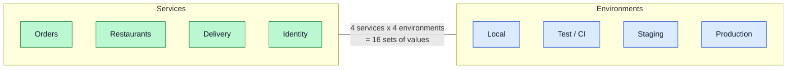
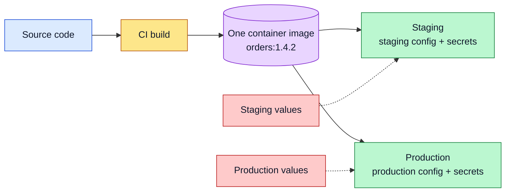
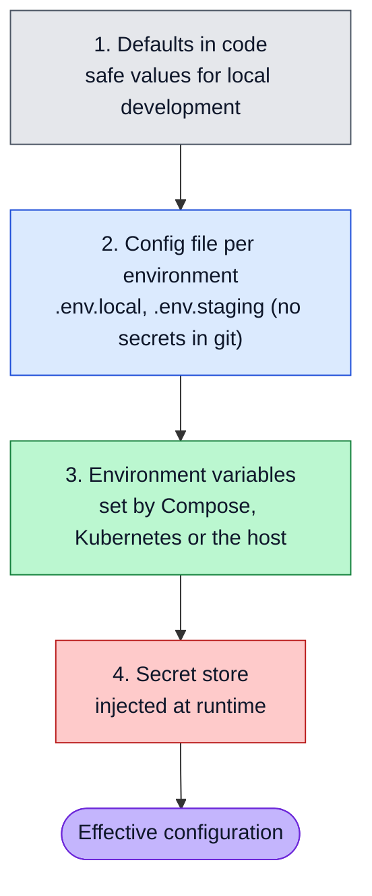
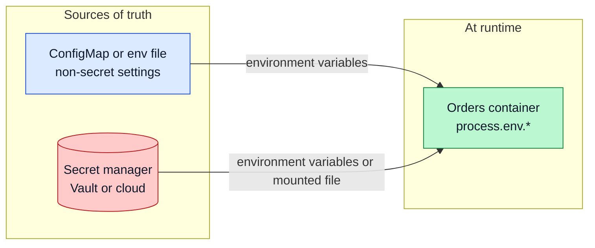
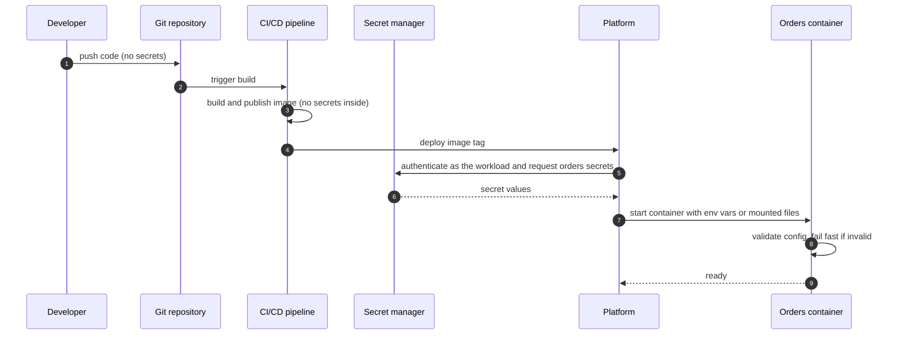
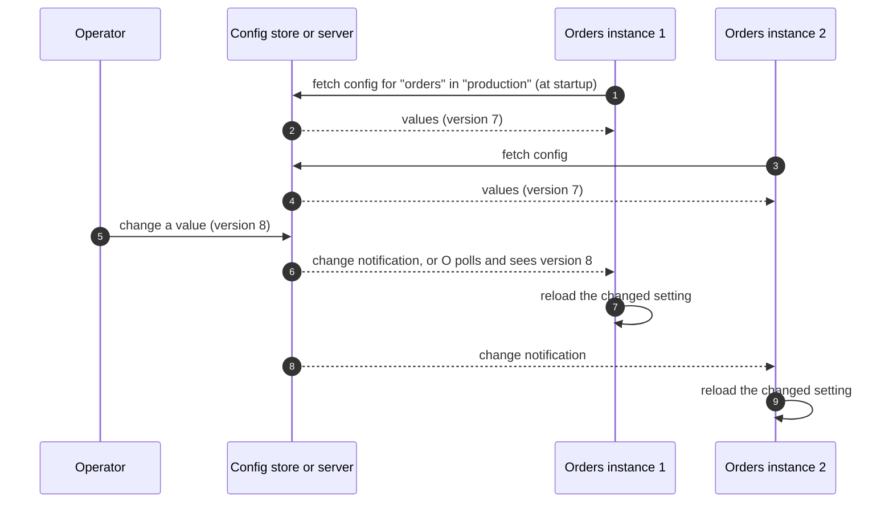
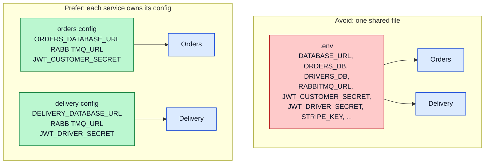

# Configuration Management

How configuration and secrets are handled across many services and environments: keeping config out of the code, layering and precedence, where each kind of value lives, centralized config, injecting secrets, and validating everything at startup in NestJS.

**Contents**

1. [The problem](#the-problem)
2. [Principles](#principles)
3. [Layers and precedence](#layers-and-precedence)
4. [Configuration vs secrets](#configuration-vs-secrets)
5. [Where values live](#where-values-live)
6. [Injecting secrets](#injecting-secrets)
7. [Centralized configuration](#centralized-configuration)
8. [Per-service configuration](#per-service-configuration)
9. [NestJS: validated configuration](#nestjs-validated-configuration)
10. [Common mistakes](#common-mistakes)

Related: [Service Discovery](service-discovery.md) (addresses as configuration) · [Reference Architecture](reference-architecture.md) · [TypeORM + Supabase](../Nest/typeorm-config.md) (database config) · [Configuration & Environments](../Dotnet/configuration-env.md) and [Options Pattern](../Dotnet/options-pattern.md) (the same ideas in ASP.NET Core)

---

## The problem

Every service needs its own settings (database URL, broker URL, keys, URLs of other services), and every one of them runs in several environments.



Hand-edited files and values copied between servers do not scale. The aim is one **built artifact** per service, configured from the outside.

---

## Principles

| Principle | Meaning |
|---|---|
| **Config lives outside the code** | Nothing environment-specific is compiled into the image or committed to git |
| **Build once, configure many** | The same container image is promoted from staging to production; only the injected values differ |
| **Secrets are different** | Passwords and keys have stricter storage, access and rotation than ordinary settings |
| **Fail fast** | A service with missing or malformed config refuses to start |
| **Each service owns its config** | No single `.env` shared by every service |



---

## Layers and precedence

Values come from several layers; a later layer overrides an earlier one. Keep the layers few and the order consistent across services.



| Layer | Typical content | Committed to git? |
|---|---|---|
| Defaults | Ports, timeouts, log level for dev | Yes |
| Environment file | Non-secret settings per environment | Only non-secret templates (`.env.example`) |
| Environment variables | Everything that changes per deployment | No, set by the platform |
| Secret store | Passwords, API keys, signing secrets | Never |

In NestJS, `ConfigModule` reads `process.env` (plus an optional env file) and `process.env` wins over the file. The same layering in ASP.NET Core is described in [Configuration & Environments](../Dotnet/configuration-env.md).

---

## Configuration vs secrets

| | Configuration | Secrets |
|---|---|---|
| Examples | `PORT`, `LOG_LEVEL`, `RABBITMQ_EXCHANGE`, `ORDERS_URL` | `DATABASE_URL` with password, `JWT_CUSTOMER_SECRET`, API keys |
| If leaked | Harmless or mildly embarrassing | Breach |
| Storage | Env vars, ConfigMaps, files | Secret manager, Kubernetes Secrets, encrypted store |
| Access | Anyone on the team | Least privilege, audited |
| Rotation | Rare | Planned and automated |
| In logs | Fine | Never |

A connection string with a password is a **secret as a whole**, even though the host part is not.

---

## Where values live

| Platform | Configuration | Secrets |
|---|---|---|
| **Local** | `.env` files (git-ignored) | The same `.env`, with development-only values |
| **Docker Compose** | `environment:` or `env_file:` | `secrets:` or an `env_file` kept out of git |
| **Kubernetes** | ConfigMap | Secret (consider encryption at rest and an external secret manager) |
| **Cloud** | Parameter store or app settings | Cloud secret manager (AWS Secrets Manager, Azure Key Vault, GCP Secret Manager) |
| **Self-hosted** | Consul KV or files | HashiCorp Vault |



---

## Injecting secrets

Secrets reach the container **at deploy or start time**, never at build time.



| Rule | Reason |
|---|---|
| No secret in the image, `Dockerfile` (`ENV`, `ARG`) or git history | Anyone with the image or repo can read it |
| The workload authenticates to the secret manager with its own identity | No shared long-lived admin credential |
| Different secrets per environment and per service | A leak in staging cannot reach production; one service cannot read another's keys |
| Rotate on a schedule and after any suspected exposure | Limits the lifetime of a leaked value |

---

## Centralized configuration

Some systems add a **configuration service** so values can change without redeploying every instance.



| Option | Good for | Cost |
|---|---|---|
| **Env vars and restart** | Most settings | A rolling restart per change; simple and predictable |
| **Central config store** (Consul, cloud parameter stores) | Many services sharing values, frequent changes | Another dependency that must be highly available |
| **Feature flags** | Turning behavior on or off at runtime | A flag service and discipline to remove old flags |

Start with environment variables and a rolling restart. Add a central store only when the cost of restarts or duplicated values is real. If the store is unreachable, a service should start from its last known values or defaults instead of failing completely.

---

## Per-service configuration

Each service defines and validates **its own** settings. A shared `.env` for everything makes every service depend on every other service's variables.



| Variable | Orders | Restaurants | Delivery | Gateway |
|---|:---:|:---:|:---:|:---:|
| Own database URL | yes | yes | yes | no |
| `RABBITMQ_URL` and exchange | yes | yes | yes | no |
| Queue name for this service | yes | yes | yes | no |
| URLs of services it calls | restaurants | none | none | all |
| Token verification key or secret | yes | yes | yes | yes |
| Signing secret for issuing tokens | no | no | no | no (Identity service only) |

The principle behind the table: **a service only receives the values it needs.**

---

## NestJS: validated configuration

`@nestjs/config` loads the environment; a validation schema makes startup fail when something is missing or wrong.

```bash
npm install @nestjs/config joi
```

```ts
import { Module } from '@nestjs/common';
import { ConfigModule } from '@nestjs/config';
import * as Joi from 'joi';

@Module({
  imports: [
    ConfigModule.forRoot({
      isGlobal: true,
      envFilePath: ['.env.local', '.env'],
      validationSchema: Joi.object({
        NODE_ENV: Joi.string().valid('development', 'test', 'production').default('development'),
        PORT: Joi.number().default(3000),
        DATABASE_URL: Joi.string().uri().required(),
        RABBITMQ_URL: Joi.string().uri().required(),
        RABBITMQ_EXCHANGE: Joi.string().required(),
        RESTAURANTS_URL: Joi.string().uri().required(),
        JWT_CUSTOMER_SECRET: Joi.string().min(32).required(),
      }),
      validationOptions: { abortEarly: false },
    }),
  ],
})
export class AppModule {}
```

| Option | Effect |
|---|---|
| `isGlobal: true` | `ConfigService` is injectable everywhere without importing `ConfigModule` again |
| `envFilePath` | Env files to load; real environment variables still take precedence |
| `validationSchema` | The app **fails at startup** if a required value is missing or invalid |
| `abortEarly: false` | Reports every problem at once, not just the first |

Read values through `ConfigService`, using `getOrThrow` so a missing value is an error rather than `undefined`:

```ts
constructor(private readonly config: ConfigService) {
  const url = this.config.getOrThrow<string>('RESTAURANTS_URL');
}
```

For grouped, typed settings use `registerAs` (as in [TypeORM + Supabase](../Nest/typeorm-config.md)). This is the Nest counterpart of ASP.NET Core's options pattern with `ValidateOnStart()` described in [Options Pattern](../Dotnet/options-pattern.md).

---

## Common mistakes

| Mistake | Why it matters | Fix |
|---|---|---|
| Committing `.env` or secrets | They stay in git history even after deletion | Git-ignore `.env`; commit only `.env.example` and rotate anything that leaked |
| Secrets in the image (`ENV`, `ARG`, copied files) | Anyone who can pull the image can read them | Inject at runtime from a secret store |
| Fallback secrets in code that reach production | Anyone who reads the repo can forge tokens | No default for secrets; make them required |
| One shared `.env` for every service | Hidden coupling, over-broad access | Per-service config with only the values needed |
| Different variable names for the same thing across services | Confusion and bugs | Agree on names (`RABBITMQ_URL`) and document them |
| No validation at startup | Misconfiguration shows up as a runtime error under load | Validation schema with required values |
| Same secrets in staging and production | A staging leak is a production leak | Separate secrets per environment |
| Logging the full config object | Secrets end up in logs | Log only non-sensitive keys, or redact |
| Changing a value without restarting or reloading | The running instances keep the old value | Rolling restart, or an explicit reload mechanism |
