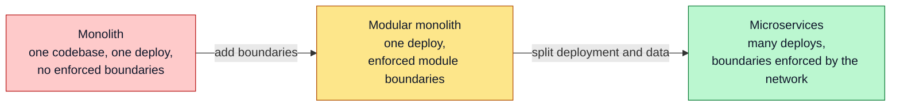
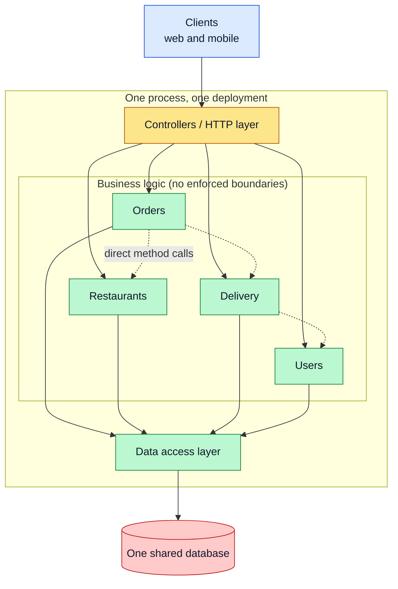
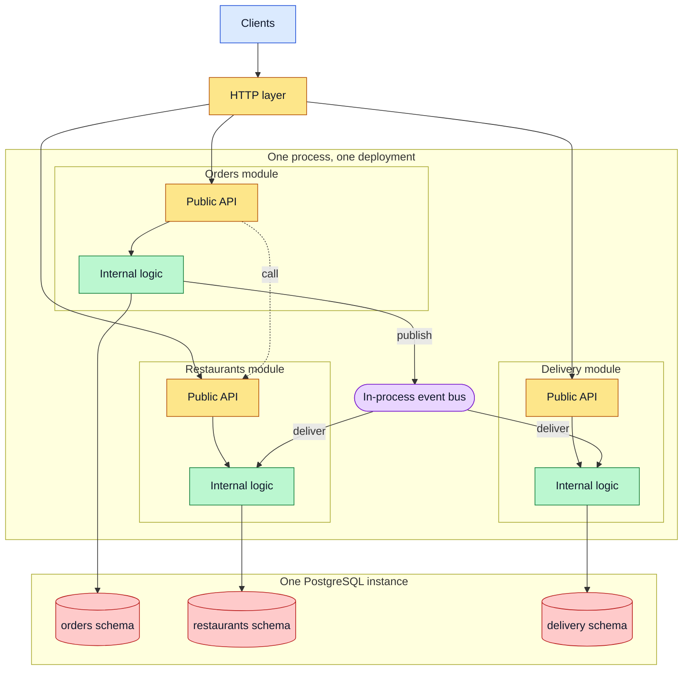
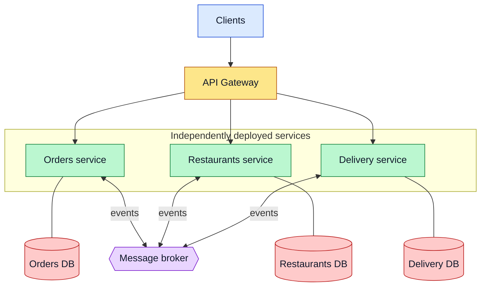
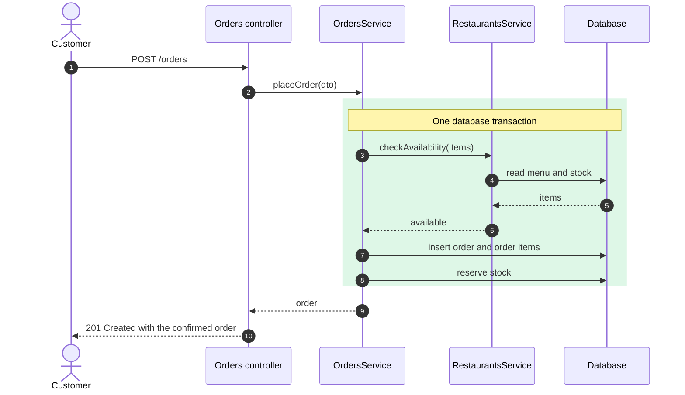
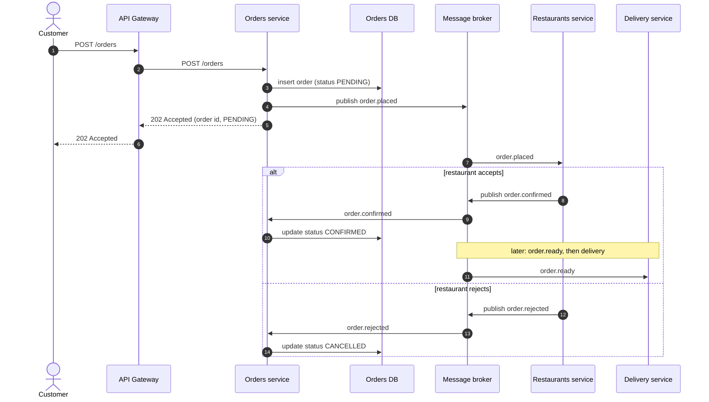
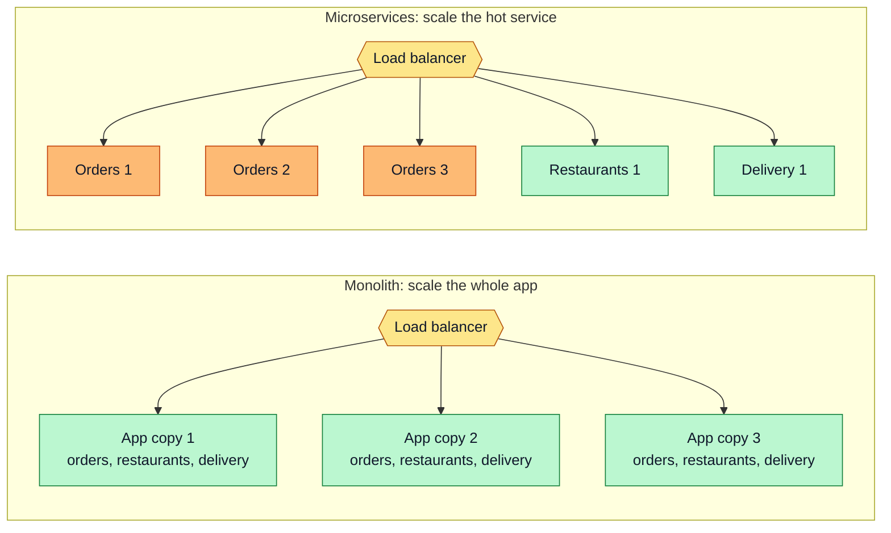
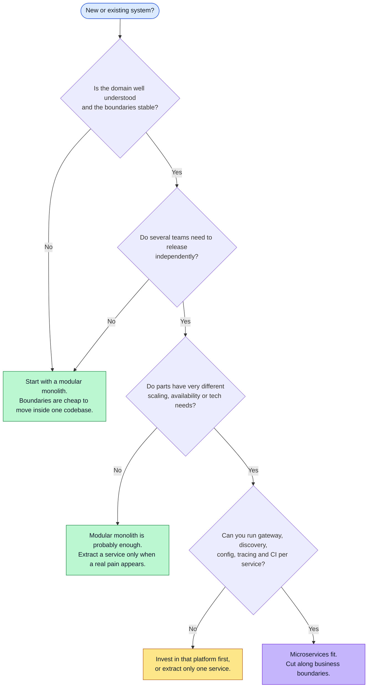
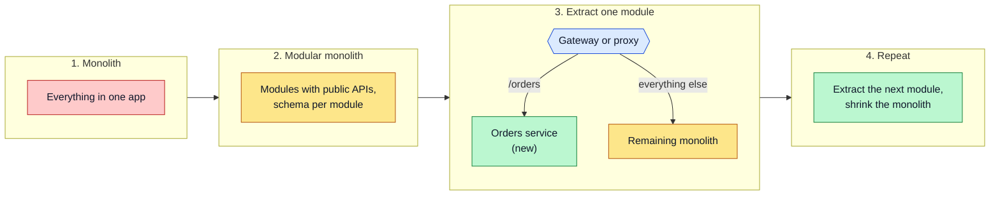
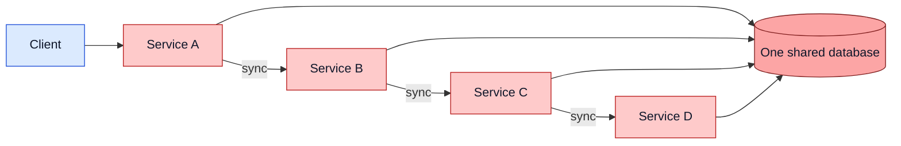

# Monolith vs Modular Monolith vs Microservices

The three common ways to structure a back end, what each one looks like at runtime, how a single request differs between them, and how to decide which one to use (and how to move from one to the next).

**Contents**

1. [Overview](#overview)
2. [The monolith](#the-monolith)
3. [The modular monolith](#the-modular-monolith)
4. [Microservices](#microservices)
5. [Side-by-side comparison](#side-by-side-comparison)
6. [How one request differs](#how-one-request-differs)
7. [Scaling](#scaling)
8. [Choosing an architecture](#choosing-an-architecture)
9. [Migrating step by step](#migrating-step-by-step)
10. [Common mistakes](#common-mistakes)

Related: [Service Boundaries](service-boundaries.md) (where to cut) · [Reference Architecture](reference-architecture.md) (the full picture) · [NestJS Modules](../Nest/nest-module.md) (modules as the building block of a modular monolith)

---

## Overview

| Style | Deployables | Database | Module-to-module calls | Best when |
|---|---|---|---|---|
| **Monolith** | 1 | 1 shared | In-process, unrestricted | Small team, small or unclear domain |
| **Modular monolith** | 1 | 1 (schema or tables per module) | In-process, through each module's public API or events | Most products; the default starting point |
| **Microservices** | Many | One per service | Network (HTTP, gRPC, messages) | Many teams, independent release and scaling needs |

The axis that matters is not "old vs new", it is **how strongly the parts are isolated** and what you pay for that isolation.

---

## The monolith

Everything is built, deployed and scaled as one unit. Any class can call any other class, and every feature reads and writes the same database.

| Strengths | Weaknesses |
|---|---|
| Simple to build, run, debug and test | Everything is deployed together: a small change ships the whole app |
| One transaction can span any data | One bug or memory leak can take down all features |
| No network between features, so it is fast | Scaling means copying the whole app, even if one feature is hot |
| One repo, one pipeline, one thing to monitor | Without discipline, code becomes tangled ("big ball of mud") |

---

## The modular monolith

Still **one deployable and one database server**, but the code is divided into modules with explicit boundaries. A module exposes a small public API (or publishes events) and hides everything else. Other modules never touch its tables directly.

The rules that make it "modular":

| Rule | Why |
|---|---|
| A module is used only through its public API or its events | Internals can change without breaking others |
| A module owns its tables; no cross-module joins or foreign keys into another module's tables | Keeps the data split-ready |
| Modules communicate with the same style they would use as services (call an API, publish an event) | Extracting one later is a deployment change, not a rewrite |

In NestJS this maps directly to a module that only `exports` its public service (see [NestJS Modules](../Nest/nest-module.md)) and to the event pattern in [RabbitMQ: Configuration and Usage](../Nest/rabbitmq-config-use.md).

---

## Microservices

Each service is its own deployable, **owns its own database**, and is reached only over the network. Services are released, scaled and failed independently.

| Strengths | Weaknesses |
|---|---|
| Deploy and scale each service on its own | Every call is a network call: latency, timeouts, partial failure |
| A failure can be contained to one service | No cross-service transactions: you accept eventual consistency |
| Teams own services end to end and choose their stack | Much more to run: gateway, discovery, config, tracing, many pipelines |
| Clear, enforced boundaries | Debugging and testing span several processes |

---

## Side-by-side comparison

| Concern | Monolith | Modular monolith | Microservices |
|---|---|---|---|
| Deployment | One unit | One unit | Per service |
| Scaling | Whole app | Whole app | Per service |
| Data | One schema, shared | Schema per module, one server | Database per service |
| Transactions | One ACID transaction | One ACID transaction (within the same database) | Sagas, eventual consistency |
| Failure isolation | None | Little | Strong, if designed for it |
| Latency between parts | In-process | In-process | Network |
| Team independence | Low | Medium | High |
| Operational cost | Low | Low | High |
| Boundary enforcement | Convention only | Code structure and review | The network itself |
| Technology choice | One stack | One stack | Per service |

---

## How one request differs

The same use case, "customer places an order", in both styles.

**Monolith / modular monolith.** One process, plain method calls, one database transaction. Either everything commits or nothing does.

**Microservices.** The Orders service only owns orders. It cannot read the Restaurants database, so it stores the order as `PENDING`, publishes an event, and finishes the flow asynchronously. The client sees the result later.

What changed:

| | Monolith | Microservices |
|---|---|---|
| Consistency | Immediate | Eventual: the order is `PENDING` before it is confirmed |
| Failure handling | Roll back the transaction | Compensating actions (cancel the order) |
| Response | `201` with the final result | `202` with a pending result; status via polling or notification |
| Coupling | Compile-time | Event contract (names and payload shape) |

---

## Scaling

A monolith scales by running more copies of everything. Microservices scale only the part under load.

---

## Choosing an architecture

A useful default: **start modular, extract when it hurts.** Moving a boundary inside a monolith is a refactor; moving it between services is a migration.

---

## Migrating step by step

The safe path is incremental (the "strangler fig" approach): put a router in front, move one capability at a time, and leave the rest where it is.

Per extraction:

1. Pick a module that already has a clean public API and its own tables.
2. Move its tables to its own database and replace cross-module reads with API calls or events.
3. Deploy it as a service and route its paths to it through the gateway.
4. Delete the old code from the monolith once traffic is stable.

---

## Common mistakes

| Mistake | Why it matters | Fix |
|---|---|---|
| Splitting into services before the domain is understood | Boundaries are guessed wrong and every change crosses services | Start as a modular monolith and extract once boundaries are stable |
| Services that share one database | Schema changes break other services; this is a distributed monolith in disguise | One database (or at least one schema with exclusive ownership) per service |
| Long chains of synchronous calls (A calls B calls C calls D) | Latency adds up and one slow service stalls the chain | Prefer events for follow-up work; keep sync calls to one hop where possible |
| Services that must always be deployed together | You pay the cost of microservices without the independence | Re-draw the boundary, or merge them |
| Too many tiny services ("nano-services") | More network calls and pipelines than the team can run | Size a service by business capability and team ownership |
| Treating the move as a rewrite | Long freeze, high risk | Strangle incrementally, one capability at a time |

The picture above is the **distributed monolith**: separate deployables that share a database and call each other in a chain, so they behave like one system that is harder to run.
