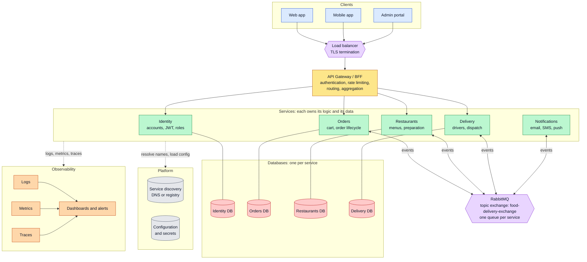
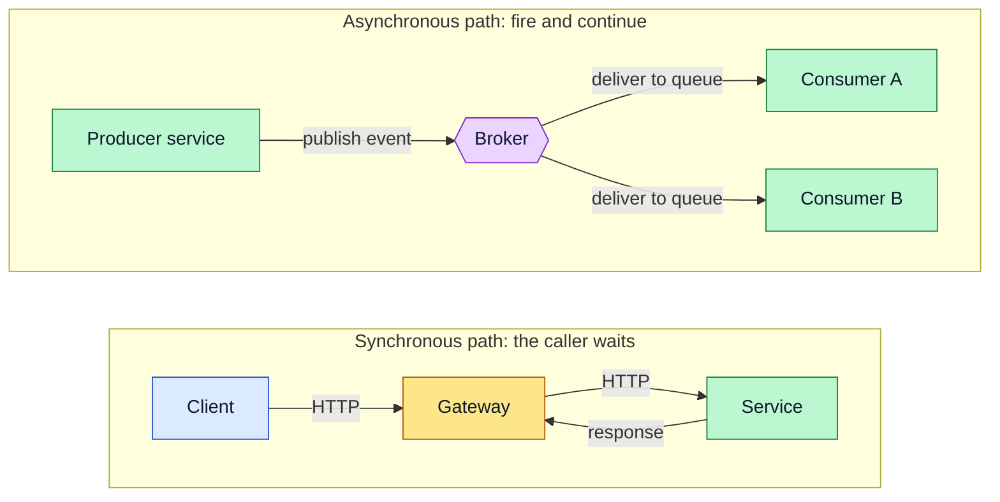
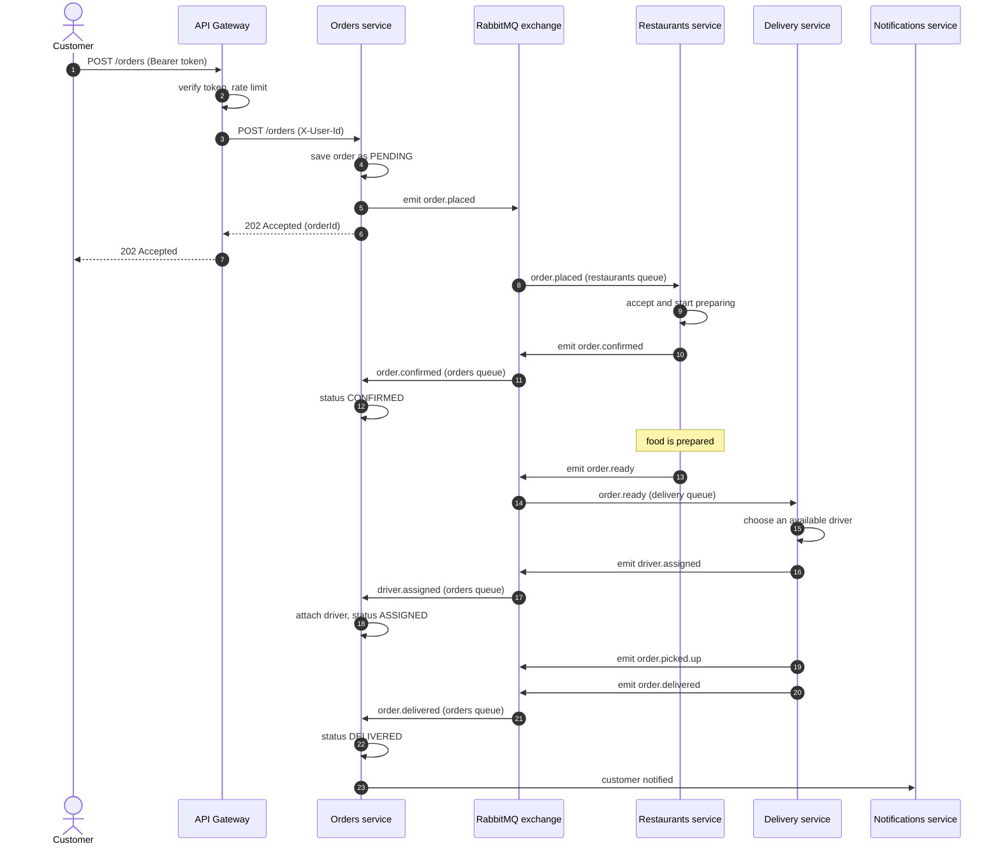
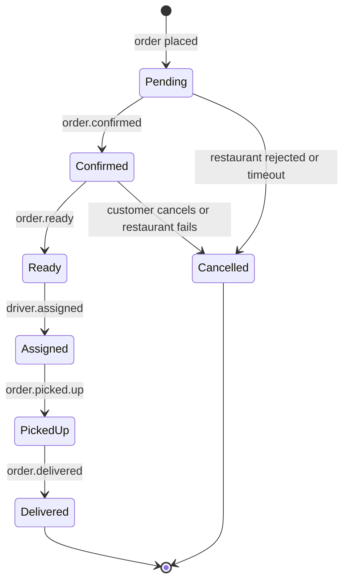
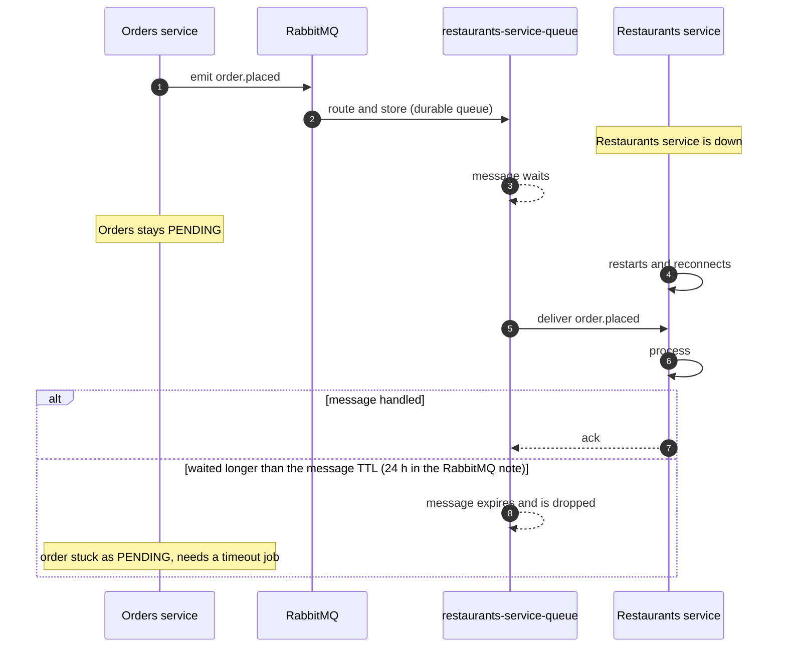
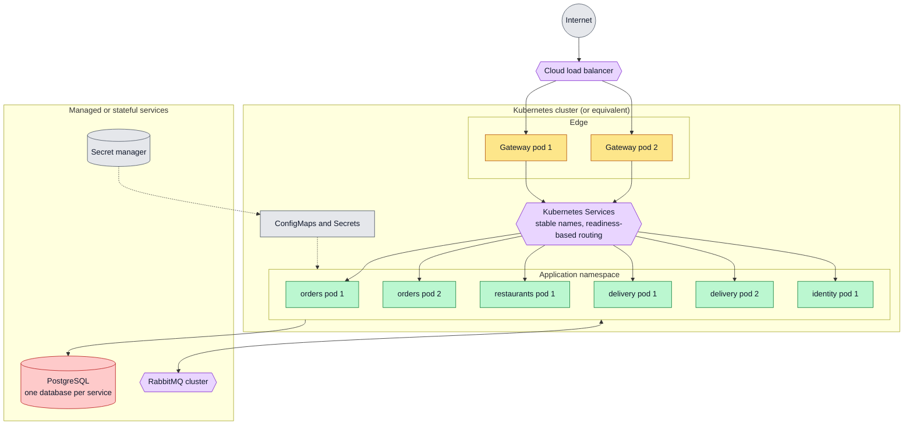
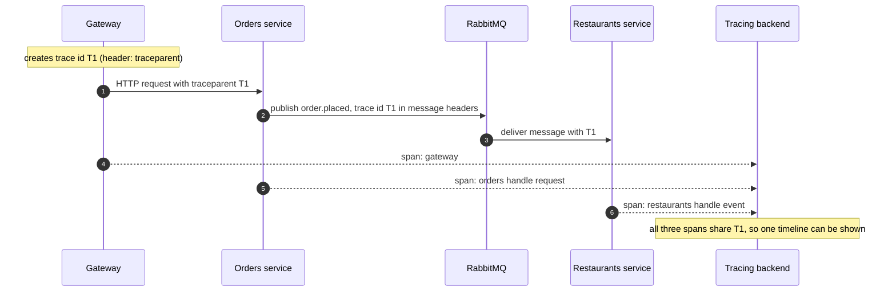

# Reference Architecture

One end-to-end picture of a microservice system built from the pieces in the other notes: the full topology, the synchronous and asynchronous paths, a complete order lifecycle, failure behavior, deployment and observability, plus a suggested order for building it.

The example is the food-delivery domain used throughout the NestJS notes (customers, restaurants, orders, drivers), including the event names from [RabbitMQ: Configuration and Usage](../Nest/rabbitmq-config-use.md).

**Contents**

1. [The whole system](#the-whole-system)
2. [Two paths: request and event](#two-paths-request-and-event)
3. [An order from start to finish](#an-order-from-start-to-finish)
4. [Order state machine](#order-state-machine)
5. [When a service is down](#when-a-service-is-down)
6. [Deployment view](#deployment-view)
7. [Observability](#observability)
8. [Where each concern is handled](#where-each-concern-is-handled)
9. [Build order](#build-order)
10. [Common mistakes](#common-mistakes)

Related: [Monolith vs Modular Monolith vs Microservices](monolith-vs-microservices.md) · [Service Boundaries](service-boundaries.md) · [API Gateway](api-gateway.md) · [Service Discovery](service-discovery.md) · [Configuration Management](configuration-management.md)

---

## The whole system

| Piece | Note |
|---|---|
| Gateway | [API Gateway](api-gateway.md) |
| Service split and data ownership | [Service Boundaries](service-boundaries.md) |
| Discovery and health checks | [Service Discovery](service-discovery.md) |
| Config and secrets | [Configuration Management](configuration-management.md) |
| Broker, queues and events | [RabbitMQ: Configuration and Usage](../Nest/rabbitmq-config-use.md) |
| Authentication and roles | [JWT Authentication](../Nest/jwt-authentication.md) |
| Error format | [Custom Exceptions](../Nest/custom-exception.md) |

---

## Two paths: request and event

Traffic takes one of two routes, and choosing the right one for each interaction is most of the design work.

| Use the synchronous path when | Use the asynchronous path when |
|---|---|
| The caller needs the answer now (read a profile, validate a token) | The work can finish later (notify, assign a driver, update a read model) |
| It is a query | It announces something that happened (a fact) |
| One service is asked and no one else needs to know | Several services may react independently |
| A short timeout is acceptable | You want the producer to keep working if a consumer is down |

---

## An order from start to finish

The full lifecycle with the event names and queue bindings from the RabbitMQ note (`ORDERS` queue: `order.confirmed`, `driver.assigned`, `order.delivered`; `RESTAURANTS`: `order.placed`; `DELIVERY`: `order.ready`, `order.picked.up`).

Points to notice:

| Point | Detail |
|---|---|
| The client gets `202`, not the final result | The order is `PENDING`; the client polls or receives a notification |
| Each service reacts only to the events it is bound to | Bindings live in `QUEUE_CONFIGS` |
| Nothing calls another service's database | Orders learns about a driver through `driver.assigned`, not by querying Delivery |
| `order.picked.up` | In the config of the RabbitMQ note only the `DELIVERY` queue is bound to it. If Orders must track pickup, add that routing key to the `ORDERS` entry |
| Notification step | Drawn as a direct call for brevity; in practice Notifications would be bound to the same events |

---

## Order state machine

The order's status changes only in response to events or validated commands.

A state machine makes **duplicate or out-of-order events** safe to handle: ignore any event that is not valid for the current state.

---

## When a service is down

Because the broker stores messages in durable queues, a consumer outage delays work instead of losing it.

| Behavior | Consequence for design |
|---|---|
| Messages wait in durable queues | Short outages are invisible to producers |
| Message TTL expires old messages | Add a **timeout** that moves stale `PENDING` orders to `CANCELLED` and notifies the customer |
| `noAck: false` (manual ack) | A message is redelivered if the consumer dies mid-processing, so handlers must be **idempotent** (safe to run twice) |
| The synchronous path has no buffer | Use timeouts and a circuit breaker so callers fail fast |

---

## Deployment view

| Layer | Runs | Scaling |
|---|---|---|
| Edge | Gateway pods | Several instances behind the load balancer |
| Applications | One deployment per service | Independently, by load |
| Data and broker | Databases, RabbitMQ | Managed service or a dedicated stateful setup, not scaled like stateless pods |
| Local development | The same containers in [Docker Compose](../Docker/docker-compose.md) | One instance of each |

---

## Observability

With many services, one user action touches many processes. You need to follow **one request across all of them**.

| Pillar | Answers | Rule of thumb |
|---|---|---|
| **Logs** | What happened in this service? | Structured (JSON), always include the trace or request ID |
| **Metrics** | Is it healthy and how loaded is it? | Request rate, error rate, latency, queue depth |
| **Traces** | Where did this request spend its time? | Propagate trace context through HTTP **and** message headers |

Queue depth deserves a dashboard of its own: a growing queue means a consumer is slow or down.

---

## Where each concern is handled

| Concern | Handled by | Note |
|---|---|---|
| TLS, public entry point | Load balancer and gateway | [API Gateway](api-gateway.md) |
| Authentication | Gateway verifies; services authorize | [JWT Authentication](../Nest/jwt-authentication.md) |
| Authorization (roles) | Each service | [JWT Authentication](../Nest/jwt-authentication.md) |
| Routing and aggregation | Gateway / BFF | [API Gateway](api-gateway.md) |
| Finding other services | DNS or registry | [Service Discovery](service-discovery.md) |
| Config and secrets | Environment and secret manager | [Configuration Management](configuration-management.md) |
| Data ownership | The owning service | [Service Boundaries](service-boundaries.md) |
| Cross-service workflows | Events and sagas | [RabbitMQ: Configuration and Usage](../Nest/rabbitmq-config-use.md) |
| Error format | Global exception filter | [Custom Exceptions](../Nest/custom-exception.md) |
| Schema changes | Migrations per service | [TypeORM + Supabase](../Nest/typeorm-config.md) |
| Containers | Docker, Compose, Kubernetes | [Docker notes](../Docker/README.md) |

---

## Build order

Do not build everything at once. Add each piece when the pain it removes is real.

```mermaid
flowchart LR
    S1["1. Modular monolith<br/>modules, schema per module,<br/>CI pipeline"]:::s1
    S2["2. Platform basics<br/>containers, per-service config,<br/>health endpoints"]:::s2
    S3["3. Gateway<br/>single entry, auth at the edge"]:::s3
    S4["4. Broker and first extracted service<br/>events, own database"]:::s4
    S5["5. Observability<br/>structured logs, metrics, traces"]:::s5
    S6["6. Resilience<br/>timeouts, retries, circuit breaker,<br/>idempotency, sagas"]:::s6
    S1 --> S2 --> S3 --> S4 --> S5 --> S6
    classDef s1 fill:#dbeafe,stroke:#1d4ed8,color:#0f172a
    classDef s2 fill:#e5e7eb,stroke:#4b5563,color:#0f172a
    classDef s3 fill:#fde68a,stroke:#b45309,color:#0f172a
    classDef s4 fill:#bbf7d0,stroke:#15803d,color:#0f172a
    classDef s5 fill:#fed7aa,stroke:#c2410c,color:#0f172a
    classDef s6 fill:#c4b5fd,stroke:#6d28d9,color:#0f172a
```

Steps 5 and 6 should not be postponed far: add basic observability **before** the second service is extracted, since debugging across services without it is slow.

---

## Common mistakes

| Mistake | Why it matters | Fix |
|---|---|---|
| Making every interaction synchronous | Failures and latency cascade through the chain | Use events for follow-up work; keep sync calls for queries that need an answer |
| Making every interaction asynchronous | Simple reads become hard to reason about | Use plain request/response for queries |
| No timeout for work stuck waiting on an event | Orders stay `PENDING` forever after a lost message | A scheduled job that expires stale states |
| Non-idempotent event handlers | Redelivery causes double effects (two drivers, two charges) | Track processed event IDs or make updates state-based |
| Services bypass the broker and call each other directly for everything | Hidden coupling and call chains | Decide per interaction which path fits |
| Adding observability last | Cross-service bugs become guesswork | Request ID and structured logs from the first service |
| Building the full platform before the product needs it | Months of infrastructure, no features | Follow the [build order](#build-order); extract only when it hurts |
