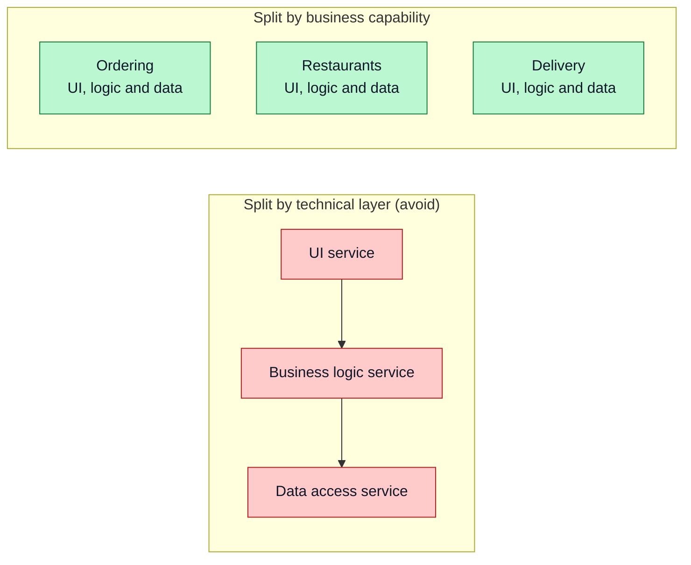
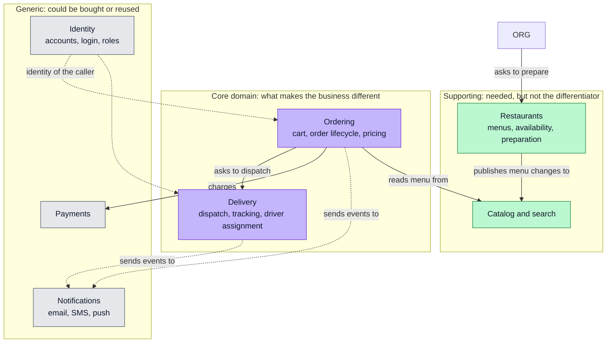
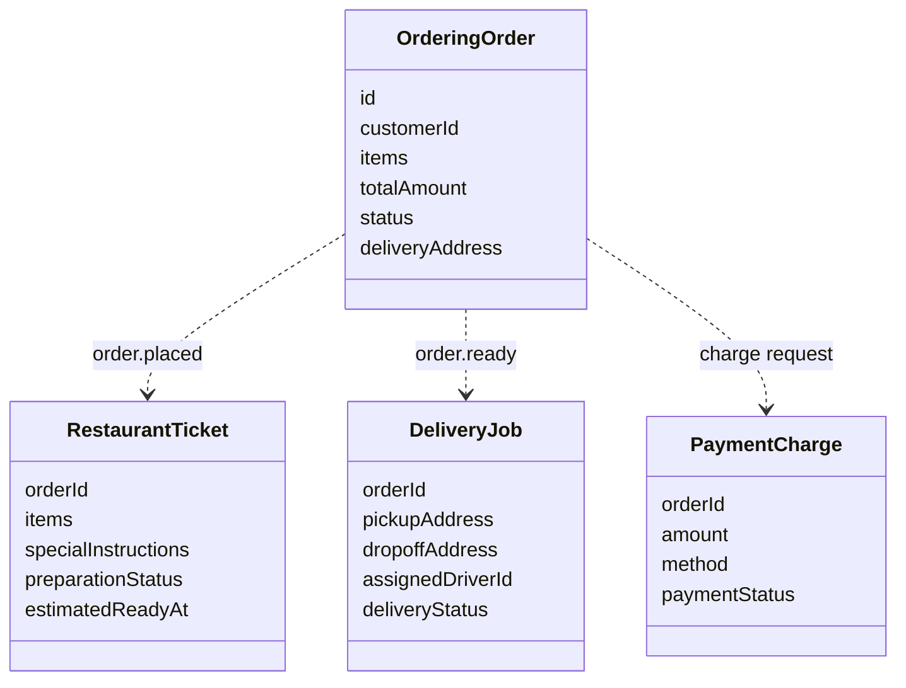
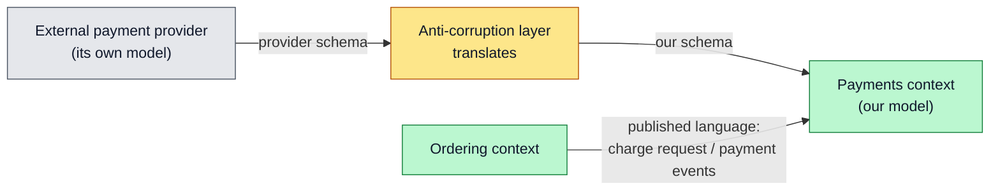
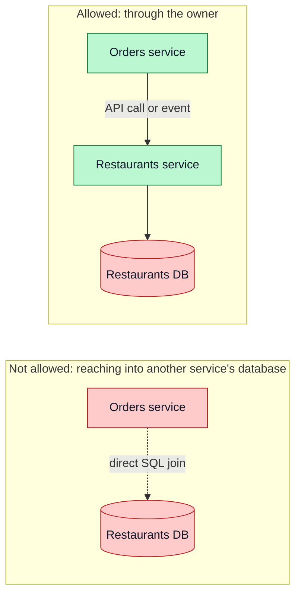
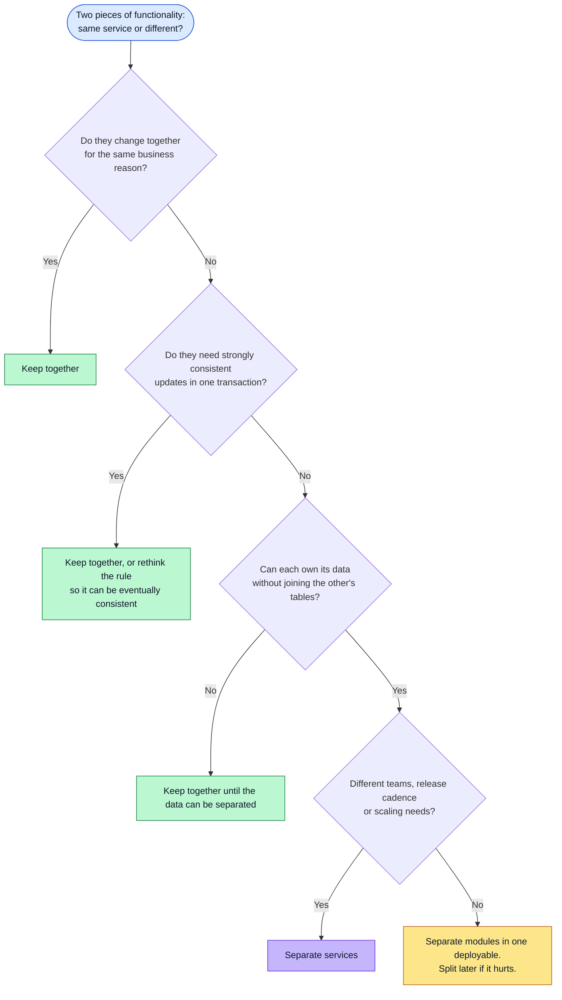

# Service Boundaries

How to decide what belongs inside one service and what belongs in another: bounded contexts, data ownership, the signals that tell you where to cut, and the splits that look reasonable but hurt later.

**Contents**

1. [Overview](#overview)
2. [Split by business capability](#split-by-business-capability)
3. [Bounded contexts](#bounded-contexts)
4. [The same word means different things](#the-same-word-means-different-things)
5. [Relationships between contexts](#relationships-between-contexts)
6. [Data ownership](#data-ownership)
7. [Where to cut: signals](#where-to-cut-signals)
8. [Granularity](#granularity)
9. [Common mistakes](#common-mistakes)

Related: [Monolith vs Modular Monolith vs Microservices](monolith-vs-microservices.md) · [Reference Architecture](reference-architecture.md) · [NestJS Modules](../Nest/nest-module.md) (one module per boundary)

---

## Overview

A service boundary is a line with three jobs:

| Job | Meaning |
|---|---|
| **Own a capability** | One service is the single place where a business rule lives |
| **Own its data** | Only that service reads and writes its tables |
| **Hide its internals** | Others see an API or events, never the implementation |

Get the lines right and most changes touch one service. Get them wrong and every feature needs coordinated releases across several.

The examples use a food-delivery domain (customers, restaurants, orders, drivers), the same one used in the NestJS notes.

---

## Split by business capability

Cut along what the business does, not along technical layers.

With a layer split, adding one field touches all three services. With a capability split, the same change stays inside one.

---

## Bounded contexts

A **bounded context** (from Domain-Driven Design) is an area of the business where every term has one precise meaning. Each context usually becomes one service, or one module in a modular monolith.

| Kind | Meaning | Investment |
|---|---|---|
| Core | The reason the business wins | Build in-house, best people, most care |
| Supporting | Necessary but not unique | Build simply |
| Generic | Solved problem | Buy or use a library or SaaS where you can |

---

## The same word means different things

"Order" is not one concept. Each context models only what it needs, so there is **no single shared `Order` class**.

Contexts link by **identifier** (`orderId`) and **events**, not by sharing the object. That is why the event DTOs in [RabbitMQ: Configuration and Usage](../Nest/rabbitmq-config-use.md) carry only the fields each consumer needs.

---

## Relationships between contexts

How two contexts relate decides who has to change when something changes.

| Relationship | Meaning | Example |
|---|---|---|
| **Customer / supplier** | Downstream asks, upstream agrees to deliver what it needs | Ordering (downstream) negotiates menu fields with Restaurants |
| **Conformist** | Downstream accepts the upstream model as is | Using a payment provider's data shape directly |
| **Anti-corruption layer** | Downstream translates the upstream model into its own | An adapter that converts the payment provider's response into `PaymentCharge` |
| **Published language** | A documented shared contract (events or API schema) | The event names and payloads on the message broker |
| **Shared kernel** | A small piece of model both teams own together | A tiny shared `Money` or `Address` type (keep it very small) |

---

## Data ownership

Each service is the **only** reader and writer of its tables. Other services get data through its API or its events.

Consequences you design for:

| Need | Without shared tables |
|---|---|
| A report joins orders with restaurants | Keep a small **local copy** of the fields you need, updated by events, or build a read model |
| A foreign key to a customer | Store the `customerId` only; no database-level foreign key across services |
| Cross-service consistency | Use a saga (a sequence of local steps with compensations) instead of one transaction |

---

## Where to cut: signals

| Signal that two things belong together | Signal that they can be apart |
|---|---|
| They change in the same commits | They change at different times for different reasons |
| One cannot work without the other's data | They exchange only identifiers and small messages |
| They must commit atomically | They can tolerate a delay between steps |
| The same small team owns both | Separate teams own them |

---

## Granularity

| Too coarse | Right-sized | Too fine ("nano-services") |
|---|---|---|
| Many unrelated rules in one service | One business capability, one team can own it | One function or table per service |
| Hard to change safely, large deploys | Changes mostly stay local | A single use case touches many services |
| Behaves like a monolith | Few, meaningful network calls | Chatty calls, heavy operations overhead |

A practical check: **can one team understand, change and deploy the service without asking another team?** If not, it is too entangled. If a use case needs five services to move, it is too fine.

---

## Common mistakes

| Mistake | Why it matters | Fix |
|---|---|---|
| Splitting by layer or by entity (`UserService`, `OrderService`, `ItemService`) | Every feature crosses all of them | Split by capability and bounded context |
| One shared `Order` model for the whole company | Any change ripples everywhere | Each context models its own version and links by id and events |
| Foreign keys or joins across services | Hidden coupling at the database level | Own the data; copy what you need via events |
| A "common" library full of domain classes | Becomes a shared kernel that forces lock-step releases | Share only tiny stable types or contracts |
| Cutting before the language of the domain is clear | The lines move constantly | Begin with modules in one deployable and extract later |
| Ignoring team structure | Services end up owned by nobody or by everybody | Align each service with one owning team |
