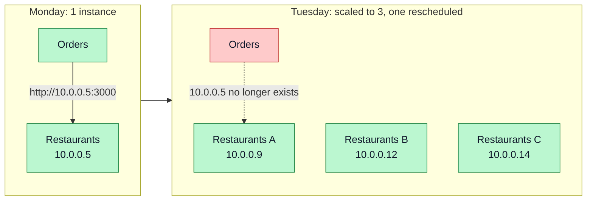
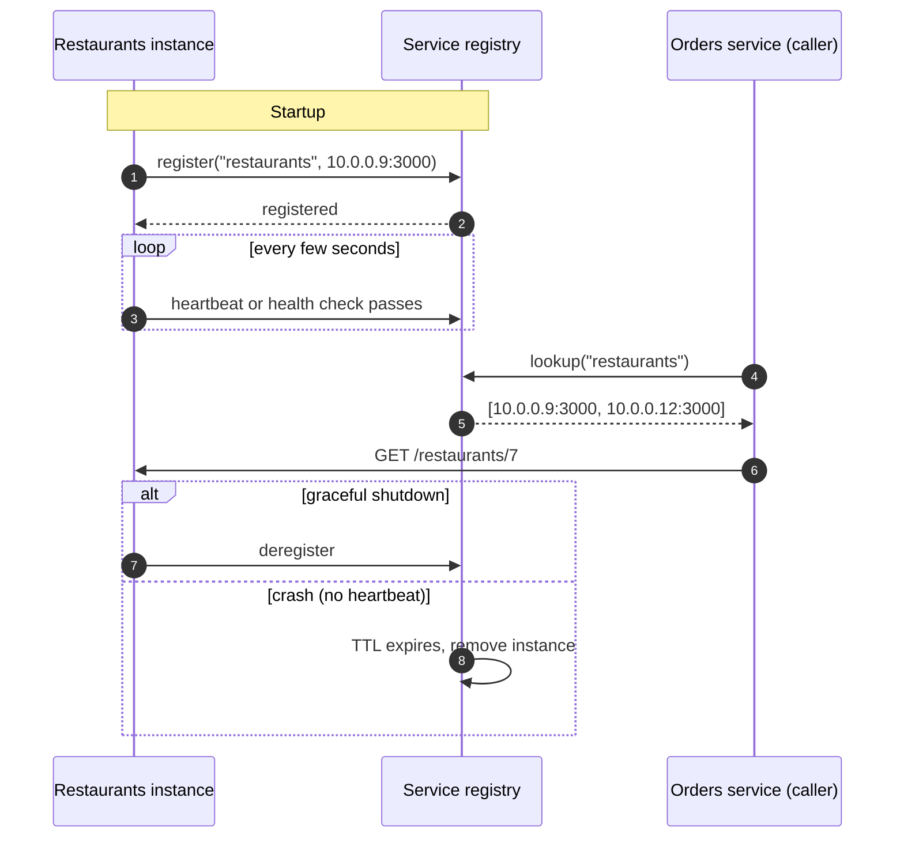
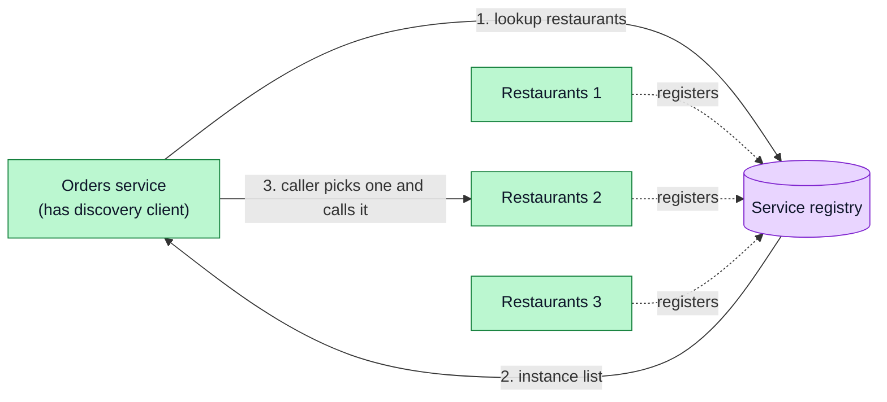
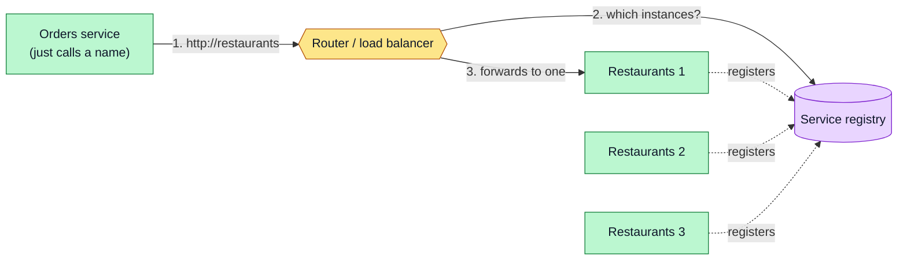
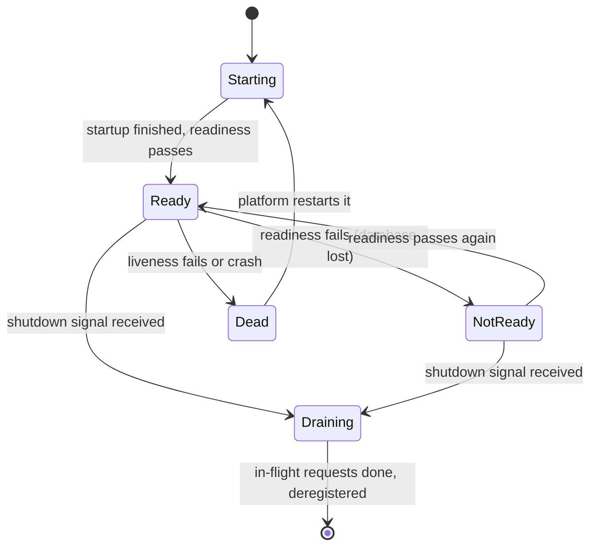
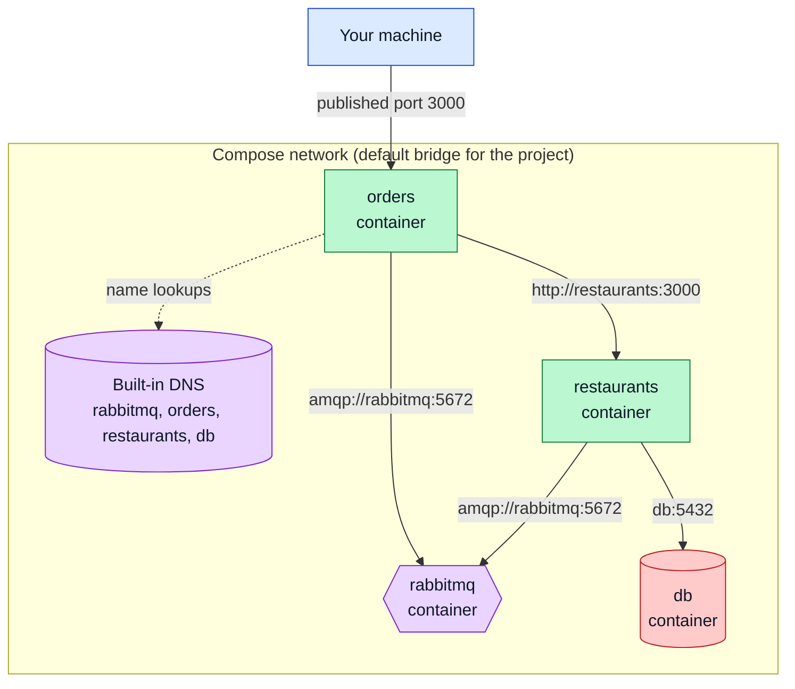
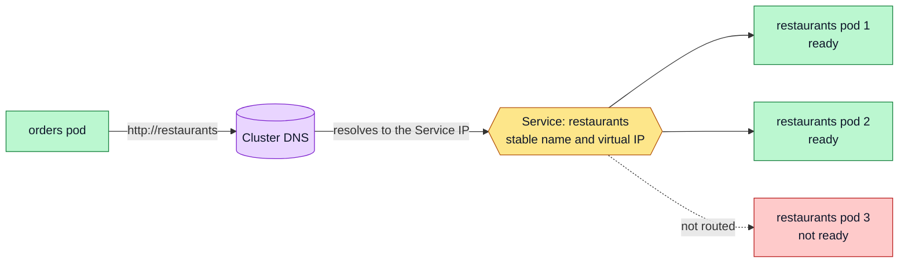

# Service Discovery

How services find each other when instances start, stop and move: the registry, client-side vs server-side discovery, health checks, and how Docker Compose and Kubernetes provide discovery for free through DNS.

**Contents**

1. [The problem](#the-problem)
2. [The service registry](#the-service-registry)
3. [Client-side vs server-side discovery](#client-side-vs-server-side-discovery)
4. [Health checks](#health-checks)
5. [Discovery in Docker Compose](#discovery-in-docker-compose)
6. [Discovery in Kubernetes](#discovery-in-kubernetes)
7. [Load balancing between instances](#load-balancing-between-instances)
8. [Tools](#tools)
9. [Common mistakes](#common-mistakes)

Related: [API Gateway](api-gateway.md) (uses discovery to route) · [Configuration Management](configuration-management.md) (addresses as configuration) · [Docker networking](../Docker/docker-networking.md) · [Docker Compose](../Docker/docker-compose.md)

---

## The problem

In a microservice system, instances are not fixed. They scale out, crash, restart and get rescheduled, and each time the address can change.



A hardcoded IP or port breaks as soon as the topology changes. Service discovery replaces "call this address" with "call **the Restaurants service**" and resolves the name to a currently healthy instance at call time.

---

## The service registry

A **registry** is a database of service names and the live instances behind each one.



| Operation | Meaning |
|---|---|
| **Register** | An instance announces its name, address and metadata |
| **Heartbeat / health check** | Proves it is still alive and ready |
| **Lookup** | A caller asks for healthy instances of a name |
| **Deregister** | Removed on clean shutdown, or after missed heartbeats (TTL) |

Who registers the instance:

| Mode | How | Example |
|---|---|---|
| **Self-registration** | The service calls the registry itself on startup | An app using a Consul or Eureka client library |
| **Third-party registration** | The platform watches what is running and registers it | Kubernetes, Docker DNS, a registrator sidecar |

Third-party registration keeps discovery code out of the services and is the default on container platforms.

---

## Client-side vs server-side discovery

The difference is **who** picks the instance.

**Client-side:** the caller asks the registry, gets the list, and chooses an instance itself.



**Server-side:** the caller sends the request to a fixed address (a load balancer or router); that component consults the registry and forwards it.



| | Client-side | Server-side |
|---|---|---|
| Extra network hop | No | Yes, through the router |
| Load-balancing logic | In every client (needs a library per language) | Centralized in the router |
| Client complexity | Higher | Minimal: call a name |
| Where it shows up | Client libraries (Eureka, Consul clients) | Kubernetes Services, cloud load balancers, gateways |

---

## Health checks

A registry is only useful if it lists **healthy** instances. Platforms distinguish three questions:

| Check | Question it answers | If it fails |
|---|---|---|
| **Liveness** | Is the process alive, or stuck? | The instance is restarted |
| **Readiness** | Can it handle traffic right now (database connected, warmed up)? | Taken out of rotation, not restarted |
| **Startup** | Has it finished booting? | Other checks wait until it passes |



Only instances in **Ready** receive traffic. Draining lets in-flight requests finish before the instance disappears.

A health endpoint in NestJS with `@nestjs/terminus`:

```ts
import { Controller, Get } from '@nestjs/common';
import { HealthCheck, HealthCheckService, TypeOrmHealthIndicator } from '@nestjs/terminus';

@Controller('health')
export class HealthController {
  constructor(
    private health: HealthCheckService,
    private db: TypeOrmHealthIndicator,
  ) {}

  @Get()
  @HealthCheck()
  check() {
    return this.health.check([() => this.db.pingCheck('database')]);
  }
}
```

Keep readiness checks cheap and limited to the service's **own** dependencies. A readiness check that calls other services can make a whole system look down when one service is slow.

---

## Discovery in Docker Compose

Compose creates a network and a DNS entry for every service, named after the **service key** in the file. No registry to run.



```yaml
services:
  rabbitmq:
    image: rabbitmq:3-management
    healthcheck:
      test: ["CMD", "rabbitmq-diagnostics", "-q", "ping"]
      interval: 10s
      timeout: 5s
      retries: 5

  restaurants:
    build: ./restaurants
    environment:
      RABBITMQ_URL: amqp://rabbitmq:5672      # service name, not localhost
    depends_on:
      rabbitmq:
        condition: service_healthy

  orders:
    build: ./orders
    ports:
      - "3000:3000"
    environment:
      RABBITMQ_URL: amqp://rabbitmq:5672
      RESTAURANTS_URL: http://restaurants:3000
    depends_on:
      rabbitmq:
        condition: service_healthy
```

| Detail | Why |
|---|---|
| Use `rabbitmq`, not `localhost` | `localhost` inside a container is the container itself |
| Only `orders` publishes a port | Other services are reachable by name inside the network, not from the host |
| `service_healthy` | `depends_on` alone only waits for the container to start, not to be ready |

The `RABBITMQ_URL=amqp://localhost:5672` shown in [RabbitMQ: Configuration and Usage](../Nest/rabbitmq-config-use.md) is for running the app on your machine; inside Compose it becomes `amqp://rabbitmq:5672`.

---

## Discovery in Kubernetes

A **Service** gives a set of pods one stable name and virtual IP; Kubernetes keeps its list of ready pods up to date and DNS resolves the name. This is server-side discovery built into the platform.



```yaml
apiVersion: v1
kind: Service
metadata:
  name: restaurants
spec:
  selector:
    app: restaurants        # pods with this label back the Service
  ports:
    - port: 80              # port callers use
      targetPort: 3000      # port the container listens on
```

| Caller location | Address |
|---|---|
| Same namespace | `http://restaurants` |
| Another namespace | `http://restaurants.<namespace>.svc.cluster.local` |

The readiness probe from [Health checks](#health-checks) decides which pods are in the Service's list.

---

## Load balancing between instances

Once a caller has several healthy instances it must choose one.

| Strategy | Behavior | Fits |
|---|---|---|
| **Round robin** | Rotate through instances in order | Similar instances and similar requests |
| **Random** | Pick any instance | Simple, avoids synchronized patterns |
| **Least connections** | Pick the instance with the fewest active requests | Requests with uneven duration |
| **Zone-aware** | Prefer instances in the same zone | Cutting latency and cross-zone cost |

Combine with **timeouts and retries** so one slow instance does not stall callers.

---

## Tools

| Tool | Type | Notes |
|---|---|---|
| **Kubernetes Services and DNS** | Platform, server-side | Default choice on Kubernetes; nothing to install |
| **Docker / Compose DNS** | Platform | Names from the service keys in the Compose file |
| **Consul** | Registry plus health checks, DNS and HTTP interfaces | Works across platforms and on VMs |
| **Eureka** | Registry, client-side | Common in the Spring ecosystem |
| **etcd** | Distributed key-value store | Backs Kubernetes; usable for custom discovery |
| **Cloud service discovery** | Managed | Cloud-specific DNS-based registries |

For most NestJS projects the answer is: **use the platform.** Compose locally, Kubernetes (or your cloud's equivalent) in production, and keep addresses in configuration.

---

## Common mistakes

| Mistake | Why it matters | Fix |
|---|---|---|
| Hardcoding IPs or ports | Breaks on every reschedule or scale event | Use service names and configuration |
| `localhost` inside containers | Points at the container itself, not the other service | Use the service name (`rabbitmq`, `restaurants`) |
| No readiness check | Traffic reaches instances that are still starting or lost their database | Add readiness and only route to ready instances |
| Readiness check that calls other services | One slow dependency marks every service unready | Check only the service's own resources |
| `depends_on` without a health condition | The dependency has started but is not ready, so the app fails at boot | `condition: service_healthy` with a healthcheck |
| Caching resolved addresses forever | Calls go to instances that no longer exist | Respect DNS TTL; re-resolve on connection errors |
| Instances that do not deregister on shutdown | Callers keep getting errors | Handle the shutdown signal, drain, then exit |
